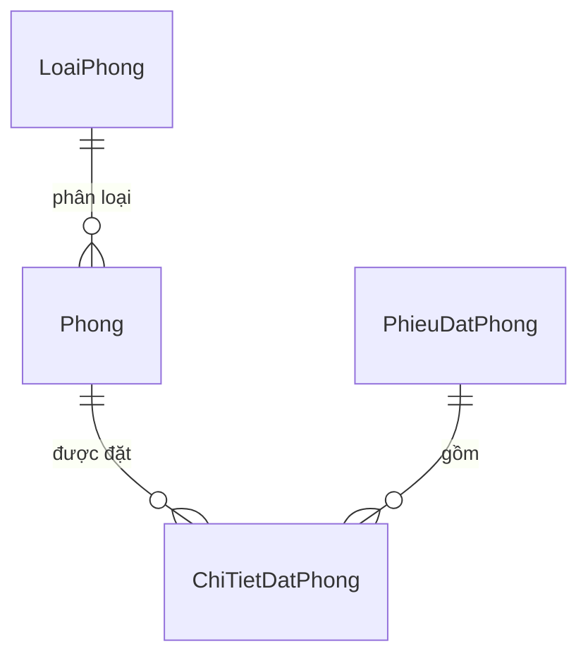

# Hotel Desk — website nhập liệu khách sạn

Giao diện web tiếng Việt dùng Flask + Jinja, chạy trong trình duyệt, kết nối cùng MySQL `hotel` với Workbench. Các trang hiện có:

- `/khach-hang`: tạo hồ sơ khách hàng; nếu CCCD trùng thì báo lỗi và giữ thông tin đã nhập.
- `/dich-vu`: thêm danh mục dịch vụ trực tiếp, không cần phòng hoặc khách đang lưu trú.
- `/danh-sach/khach-hang`: xem toàn bộ khách hàng dưới dạng bảng.
- `/danh-sach/dich-vu`: xem toàn bộ dịch vụ dưới dạng bảng.

Chưa triển khai màn hình tìm kiếm nghiệp vụ (mục 6). Không dùng CustomTkinter nữa.

## Báo cáo lượt đặt theo loại phòng

Nguồn cấu trúc và dữ liệu của bài tập lớn là `sql/khach-san.sql` và `sql/nhap-lieu-khach-san.sql`. Trên database mới, chạy lần lượt hai file này trong Workbench, giữ `SET @chi_bo_sung = FALSE;`. File nhập liệu giữ nguyên 91 bản ghi ban đầu và thêm 13 bản ghi cho ba tình huống đặt phòng, tổng 104 bản ghi. Nếu đã nạp bộ 91 bản ghi cũ, đổi dòng trên thành `SET @chi_bo_sung = TRUE;` rồi chạy toàn bộ file nhập liệu để chỉ bổ sung; không chạy lại file tạo database. Nếu đã bổ sung, chỉ chạy truy vấn báo cáo. File lấy khóa tự tăng bằng `LAST_INSERT_ID()` và rollback dữ liệu của lần chạy khi có lỗi hoặc trùng phiếu. File cần quyền `CREATE ROUTINE`, `ALTER ROUTINE`, `EXECUTE`, `INSERT`, `SELECT`; thủ tục hỗ trợ được xóa sau khi chạy thành công. Xem [hướng dẫn dữ liệu và kiểm thử](docs/du-lieu-va-kiem-thu.md).

Để đối chiếu số liệu trực tiếp, chạy toàn bộ `sql/bao-cao-loai-phong.sql` (MySQL 8.0+). File chỉ đọc database `hotel`, không lọc theo khách hoặc tên loại phòng riêng. Hai biến `@bc_tu_ngay`, `@bc_den_ngay` xác định kỳ báo cáo. Các bảng kết quả gồm thông tin người lập/người nhận, thống kê, từng chi tiết và tổng đối chiếu. Với bộ dữ liệu sau bổ sung, chọn **01/10/2026–31/10/2026**: **10 phiếu hợp lệ, 12 lượt hợp lệ, 2 chi tiết bị loại do hủy**. Standard Single có 3 lượt (25,00%); Standard Double và Superior Single mỗi loại 2 lượt (16,67%); năm loại còn lại mỗi loại 1 lượt (8,33%). Số liệu thay đổi theo dữ liệu thực tế trong database.

Mở **Báo cáo thống kê → Lượt đặt theo loại phòng**, hoặc `/bao-cao/loai-phong`. Chọn **Từ ngày – Đến ngày**, nhập tên khách sạn, rồi bấm **Xem báo cáo** hoặc **Xuất Excel (.xlsx)**. Kỳ mặc định từ đầu tháng hiện tại đến hôm nay, theo múi giờ Việt Nam.

**Trưởng bộ phận Lễ tân** lập báo cáo cuối tháng và gửi **Ban Giám đốc khách sạn** để theo dõi loại phòng được đặt nhiều/ít, phục vụ chương trình khuyến mãi và kế hoạch kinh doanh. Tên khách sạn được dùng làm tiêu đề. Việc gửi báo cáo do người lập thực hiện sau khi tải file.

Bảng báo cáo gồm **STT | Loại phòng | Số lượt đặt | Tỷ lệ (%)**, có tổng cộng và vùng ký tên. File Excel dùng Times New Roman, bảng kẻ khung, định dạng số, khổ A4 dọc, tỷ lệ in 100% và bốn cột nằm trong chiều ngang trang. Báo cáo dài được ngắt trang để giữ hai dòng dữ liệu cuối, tổng cộng, ghi chú và chữ ký cùng nhau; tiêu đề được lặp khi in nhiều trang.

Khi in: chọn A4 và giữ tỷ lệ 100% theo file. Nếu Excel xuất ra Letter dù trang đã chọn A4, kiểm tra **File → Options → Advanced → Print → Scale content for A4 or 8.5 x 11" paper sizes** và bỏ chọn khi cần in đúng A4. Xem Print Preview trước khi in vì máy in có thể áp dụng khổ giấy riêng. Bản in có khoảng trống để ký và ghi họ tên bằng tay.

Quy tắc tính:

- Kết nối `ChiTietDatPhong → Phong → LoaiPhong`, thêm `PhieuDatPhong` để lọc theo `NgayDat`, bao gồm cả ngày đầu và ngày cuối kỳ.
- Một `MaChiTietDatPhong` là một lượt đặt phòng. Một phiếu đặt ba phòng tính ba lượt; không đếm số phiếu, số khách hoặc số đêm lưu trú.
- **Không bao gồm phiếu đã hủy.** Do trạng thái đang là văn bản tự do, truy vấn nhận diện `Đã hủy`, `Đã huỷ`, `Hủy`, `Huỷ`, `Da huy`, `Huy`, không phân biệt hoa thường và khoảng trắng hai đầu. Khi bổ sung cách ghi trạng thái hủy mới, cập nhật đồng thời danh sách trong `database.list_room_type_bookings` và `sql/bao-cao-loai-phong.sql`.
- Nhóm theo mã loại phòng, hiển thị cả loại phòng có 0 lượt, sắp xếp số lượt giảm dần rồi mã loại phòng tăng dần. Phân loại theo loại phòng hiện tại trong bảng `Phong`.
- Tỷ lệ bằng số lượt của từng loại chia tổng lượt hợp lệ. Hiển thị hai số thập phân; tổng là 100% khi có lượt, 0% khi không có lượt. Các tỷ lệ từng dòng có thể lệch tổng 100% do làm tròn.

Màn hình và Excel dùng chung truy vấn và phép tính. Mỗi lần bấm nút sẽ đọc dữ liệu hiện tại trong MySQL; nếu dữ liệu thay đổi giữa hai lần bấm, kết quả có thể thay đổi tương ứng. Lỗi ngày hoặc thông tin nhập sẽ được báo trên biểu mẫu; lỗi MySQL không tạo file Excel. Không cần sửa schema hoặc chạy lại SQL. Tài khoản MySQL cần quyền `SELECT` trên bốn bảng nói trên.

Kiểm thử báo cáo bằng `.\.venv\Scripts\python.exe -m unittest discover -s tests -v`. Kiểm thử dùng dữ liệu giả lập trong bộ nhớ, không ghi vào MySQL thật.

### Giải thích logic khi báo cáo môn CSDL

Schema hiện tại tách danh mục `LoaiPhong` thành bảng riêng. Đã có [sơ đồ đầy đủ và thuyết minh](docs/so-do-quan-he.md), [ảnh PNG để chèn vào bài](docs/so-do-quan-he.png) và [SVG](docs/so-do-quan-he.svg) theo đúng schema: 11 bảng, 54 cột, 12 khóa ngoại. Sơ đồ dùng `Phong.MaLoaiPhong` tham chiếu `LoaiPhong.MaLoaiPhong`, thay cho thuộc tính `Phong.LoaiPhong` trong ảnh cũ. Bốn bảng tham gia báo cáo có quan hệ:



1. Lọc phiếu theo `PhieuDatPhong.NgayDat` trong kỳ và loại phiếu đã hủy. Phiếu đặt trước kỳ nhưng nhận phòng trong kỳ không thuộc báo cáo này; phiếu chưa nhận phòng vẫn được tính nếu chưa bị hủy.
2. Từ mỗi chi tiết, khóa ngoại xác định đúng một phiếu, một phòng và một loại phòng. Vì vậy mỗi chi tiết chỉ xuất hiện một lần trong tập cần đếm. Không nối thêm bảng khách lưu trú, dịch vụ hoặc thanh toán vì các quan hệ nhiều dòng đó có thể làm tăng sai số lượt.
3. `COUNT(MaChiTietDatPhong)` và `GROUP BY MaLoaiPhong` tính số phòng được đặt theo loại. Một phiếu đặt ba phòng là ba lượt; không dùng `COUNT(DISTINCT MaPhieu)` để tính chỉ tiêu này. Hai loại khác mã nhưng trùng tên vẫn là hai nhóm riêng.
4. Tổng hợp trước rồi `LEFT JOIN` từ danh mục loại phòng để giữ các loại chưa có lượt đặt. `COALESCE` đổi giá trị thiếu thành 0. Nếu chuyển điều kiện ngày/trạng thái xuống `WHERE` sau phép nối ngoài thì có thể làm mất các loại có 0 lượt.
5. Tỷ lệ dùng cùng tập lượt hợp lệ ở cả tử số và mẫu số. Tổng lượt bằng 0 thì tỷ lệ bằng 0, tránh chia cho 0. Đây là cơ cấu lượt đặt, không phải công suất phòng hoặc doanh thu.

SQL đối chiếu trả cả chi tiết được tính/bị loại và số phiếu khác với số lượt để giải thích kết quả. Với dữ liệu tháng 10/2026 sau bổ sung: 10 phiếu hợp lệ, 12 lượt hợp lệ, 2 chi tiết thuộc phiếu hủy. Chọn riêng ngày 20/10 để thấy 1 phiếu có 3 phòng; chọn 25/10 để thấy hai chi tiết bị loại; chọn tháng 11 để thấy không có lượt đặt dù có lịch nhận phòng trong tháng 11. Bộ kiểm thử còn kiểm tra hai đầu kỳ, tên loại trùng và kỳ trống. File Excel là kết quả tại thời điểm xuất; thay đổi database thì cần xuất lại.

## Báo cáo doanh thu dịch vụ

Mở **Báo cáo thống kê → Doanh thu dịch vụ** trên sidebar, hoặc `/bao-cao/doanh-thu-dich-vu`. Chọn khoảng ngày, nhập tên đơn vị trên báo cáo rồi bấm **Xem báo cáo** hoặc **Xuất Excel (.xlsx)**. Cài lại `pip install -r requirements.txt` để có thư viện `openpyxl`.

Báo cáo đọc bảng `LanSuDungDichVu` kết hợp `DichVu`, gồm cả ngày bắt đầu và ngày kết thúc. Doanh thu tính bằng số lượng nhân đơn giá áp dụng lúc sử dụng; một dịch vụ có nhiều đơn giá được tách thành các dòng riêng. Số lượng lẻ và phần lẻ của thành tiền được giữ nguyên. Tên đơn vị chỉ dùng làm tiêu đề, không lọc dữ liệu theo chi nhánh. File Excel giữ mẫu báo cáo với tổng cộng, ngày lập, vùng ký và cấu hình in A4. Ngày lập dùng múi giờ Việt Nam.

Tài khoản MySQL cần quyền `SELECT` trên hai bảng này. Không có dữ liệu thì báo cáo hiển thị rỗng với tổng bằng 0; lỗi truy vấn sẽ báo lỗi và không tải file Excel. Không cần chạy lại SQL hay tạo thủ tục. Các URL cũ `/bao-cao`, `/bao-cao-2`, `/bao_cao_2` vẫn dùng được.

Giao diện dạng bảng điều khiển: sidebar bên trái có nhóm **Quản lý thông tin** chứa hai mục con **Hồ sơ khách hàng** và **Danh mục dịch vụ**; vùng nội dung bên phải chứa tiêu đề và biểu mẫu. Trên màn hình nhỏ, dùng nút **Menu** để mở thanh chức năng.

Nhóm **Danh sách dữ liệu** trên sidebar chứa **Danh sách khách hàng** và **Danh sách dịch vụ**. Hai trang đọc toàn bộ dòng từ bảng `KhachHang`/`DichVu`, sắp xếp theo mã tự tăng từ nhỏ đến lớn để dữ liệu nhập trước ở trên, nhập sau ở cuối danh sách, hiển thị tổng số bản ghi. Cột mã khóa chính được ẩn trên giao diện và thay bằng **STT**, đánh số liên tục từ 1 tăng dần; mã trong database được giữ nguyên. Nút **Làm mới** đọc lại dữ liệu MySQL, kể cả dữ liệu thêm từ Workbench, và đánh lại STT theo danh sách hiện tại. Bảng cuộn ngang trên màn hình nhỏ; giá trị SQL NULL hiển thị là `NULL`, chuỗi rỗng giữ nguyên ô trống. Mỗi dòng có nút **Sửa** mở biểu mẫu chứa dữ liệu hiện tại.

Để chỉnh dữ liệu: vào danh sách khách hàng/dịch vụ → **Sửa** ở dòng cần đổi → chỉnh thông tin → **Lưu thay đổi**. Có thể sửa họ tên, CCCD, số điện thoại; hoặc tên dịch vụ, đơn vị tính, đơn giá, trạng thái cung cấp. Nút **Hủy** quay về danh sách. Cập nhật theo mã gốc, không tạo dòng mới, không đổi khóa chính hay thứ tự dòng. Khi dữ liệu không hợp lệ hoặc CCCD trùng, biểu mẫu giữ thông tin đã nhập và báo lỗi. Bản ghi đã bị xóa sẽ được thông báo và quay về danh sách.

## Chạy trên Windows

Python 3.11 trở lên và MySQL 8.0.16 trở lên để thực thi các ràng buộc `CHECK`. Khi thiết lập MySQL lần đầu, chạy `sql/khach-san.sql` để tạo database `hotel` và các bảng, rồi nạp `sql/nhap-lieu-khach-san.sql`. Nếu đã có dữ liệu, dùng chế độ bổ sung mô tả ở trên; không chạy lại script tạo database.

`sql/khach-san.sql` định nghĩa bảng và ràng buộc, không có trigger và không thêm dữ liệu. Dữ liệu nghiệp vụ được nạp bằng `sql/nhap-lieu-khach-san.sql`. Hai form Khách hàng và Danh mục dịch vụ có thể nhập dữ liệu ngay khi các bảng đang trống.

```powershell
python -m venv .venv
.\.venv\Scripts\python.exe -m pip install -r requirements.txt
.\.venv\Scripts\python.exe app.py
```

Nhập mật khẩu MySQL trong terminal (không hiển thị và chỉ giữ trong bộ nhớ), rồi mở **http://127.0.0.1:5000**. Dừng bằng Ctrl+C. Có thể cấu hình `MYSQL_PASSWORD` qua biến môi trường phía server để bỏ qua lời nhắc. Không nhập mật khẩu database trên website.

Kết nối mặc định: `127.0.0.1:3306`, tài khoản `tungquan26`, database `hotel`. Đặt `MYSQL_HOST`, `MYSQL_PORT`, `MYSQL_USER` nếu khác; ví dụ `$env:MYSQL_USER = "root"` trước khi chạy app nếu Workbench dùng tài khoản root. `PORT` đổi cổng website. Đây là cấu hình chạy cục bộ, chỉ lắng nghe trên loopback; chưa thiết lập tài khoản đăng nhập hoặc triển khai dùng chung qua Internet.

## Cấu trúc

Hai trang Khách hàng và Danh mục dịch vụ kiểm tra dữ liệu ở phía server, dùng `INSERT` có tham số để thêm và `UPDATE ... WHERE` có tham số để sửa bảng `KhachHang` và `DichVu`, rồi commit khi thành công. Không cần stored procedure hoặc chạy `--init-db`. Tài khoản MySQL cần quyền `SELECT`, `INSERT` và `UPDATE` trên cả `KhachHang` và `DichVu`.

```text
app.py                         Điểm chạy web, nhập mật khẩu ở terminal
sql/                           Schema, dữ liệu nghiệp vụ và SQL đối chiếu báo cáo
config.py / database.py         Cấu hình và thao tác MySQL hiện có
web/__init__.py                 Application factory, CSRF, cấu hình phiên
web/routes.py                   Các trang thêm/sửa GET/POST và danh sách GET
web/validation.py               Kiểm tra dữ liệu phía server
web/templates/base.html        Sidebar, thanh tiêu đề, bố cục, thông báo, footer
web/templates/components/      Macro trường nhập, select, CSRF dùng chung
web/templates/guests.html      Nội dung riêng của trang khách hàng
web/templates/services.html    Nội dung riêng của trang dịch vụ
web/templates/data_list.html   Bảng dữ liệu dùng chung cho khách hàng/dịch vụ
web/static/css/system.css      Design tokens, component và responsive
web/static/js/interface.js     Menu mobile, phản hồi khi gửi biểu mẫu
web/static/fonts/              Host Grotesk tự lưu trữ và giấy phép OFL
DESIGN.md                      Đặc tả thiết kế do chủ dự án cung cấp
tests/test_room_report.py      Kiểm thử logic lượt đặt, HTTP và file Excel
tests/check_mysql_report.py    Kiểm tra tích hợp trên MySQL riêng, không cần Git
docs/                         Sơ đồ, thuyết minh và hướng dẫn dữ liệu/kiểm thử
tools/generate_schema_diagram.py  Tạo Mermaid/SVG từ schema SQL
output/qa/                    Kết quả kiểm tra tạm và database thử nghiệm
output/bao-cao/                Excel/PDF xuất từ bộ dữ liệu SQL
```

## Kiểm thử

```powershell
.\.venv\Scripts\python.exe -m unittest discover -s tests -v
```

Kiểm thử logic chạy câu truy vấn trên SQLite trong bộ nhớ; không thay thế kiểm tra tương thích MySQL. Trước khi báo cáo, chạy `sql/bao-cao-loai-phong.sql` trong MySQL và đối chiếu với màn hình/Excel cùng khoảng ngày. Kiểm tra bằng trình duyệt và Print Preview của Excel; website luôn đọc MySQL được cấu hình trong `config.py`.

Kiểm tra tích hợp: `.\.venv\Scripts\python.exe tests/check_mysql_report.py`. Công cụ mở MySQL riêng ở cổng 33079, tự nạp SQL và kiểm tra nạp mới/bổ sung, rollback, không trùng lịch, hoàn cọc và đối chiếu SQL–màn hình–Excel. Không dùng database đang chạy ở cổng 3306. Xem [cách chạy và giải thích từng file trong output/qa](docs/du-lieu-va-kiem-thu.md).

## Thử nhập danh mục dịch vụ

Mở `/dich-vu`, nhập tên `Nước uống`, đơn vị `chai`, đơn giá `20000`, trạng thái `Đang cung cấp`, rồi bấm **Lưu dịch vụ**. Không cần tạo phòng hoặc lượt lưu trú. Giá là số nguyên đồng từ 0 đến 99999999999999, không dùng dấu chấm/phẩy phân cách. Tên tối đa 100 ký tự, đơn vị tối đa 30 ký tự.

Nhập trực tiếp bằng SQL:

```sql
use hotel;
insert into DichVu (TenDichVu, DonViTinh, DonGiaHienHanh, TrangThai)
values ('Nước uống', 'chai', 20000, 'Đang cung cấp');
commit;
```

Trong một tab Query của Workbench, chạy lại câu sau để xem dịch vụ mới:

```sql
select MaDichVu, TenDichVu, DonViTinh, DonGiaHienHanh, TrangThai
from hotel.DichVu
order by MaDichVu desc
limit 20;
```

Đối chiếu dòng mới nhất với thông tin vừa nhập. Refresh trang sau khi lưu không thêm dòng; bấm lưu một biểu mẫu hợp lệ lần nữa sẽ tạo dịch vụ mới, kể cả trùng tên. Nút **Làm mới** xóa biểu mẫu và đưa trạng thái về `Đang cung cấp`.

Thử giá `-1`, `1.5`, `20.000` hoặc để trống tên/đơn vị: phải báo lỗi và không thêm dữ liệu. Giá `0` hợp lệ; trạng thái `Ngừng cung cấp` cũng được lưu. Nếu lỗi database, kiểm tra thông báo mã MySQL trên trang.

## Thêm trang

Đọc `DESIGN.md`. Tạo template kế thừa `base.html`, sử dụng macro trong `components/forms.html` và class trong `system.css`. Đăng ký route và thêm liên kết điều hướng ở một nơi trong `base.html`. Không sao chép header, footer, CSS hoặc mã kết nối database sang từng trang.
