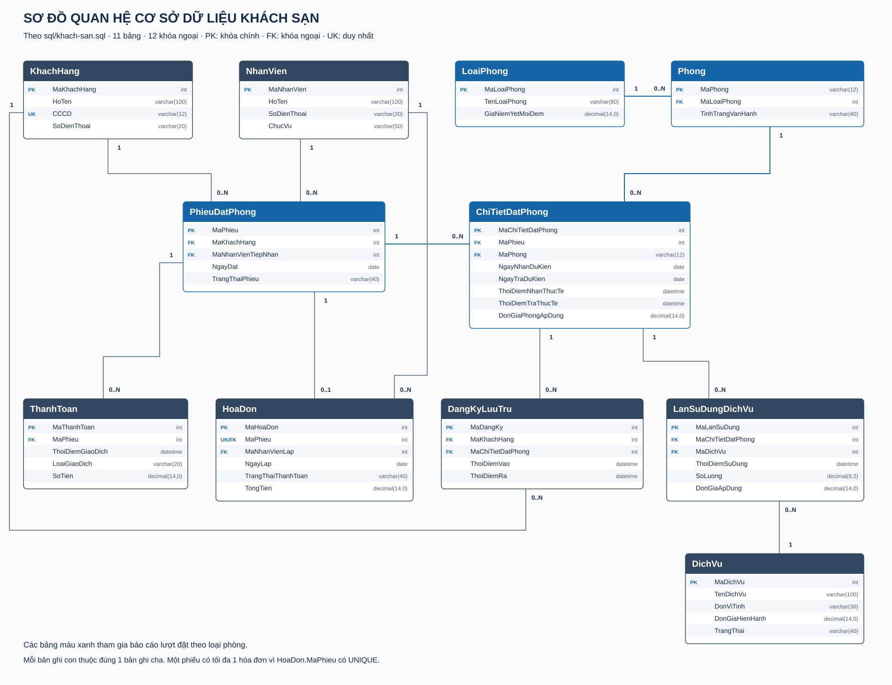

# Sơ đồ và thuyết minh cơ sở dữ liệu khách sạn

Nguồn chuẩn là [`sql/khach-san.sql`](../sql/khach-san.sql). [Sơ đồ SVG](so-do-quan-he.svg) chứa đủ 11 bảng, các cột và 12 khóa ngoại; có thể chèn vào Word. [Mã Mermaid](so-do-quan-he.mmd) dùng để chỉnh sửa hoặc hiển thị trong trình soạn thảo hỗ trợ Mermaid.

## Khác biệt với sơ đồ nghiệp vụ ban đầu

- Tách thuộc tính loại phòng thành bảng `LoaiPhong(MaLoaiPhong, TenLoaiPhong, GiaNiemYetMoiDem)`. Bảng `Phong` tham chiếu qua `MaLoaiPhong`; không lưu lặp tên loại và giá niêm yết ở từng phòng.
- `LoaiPhong.GiaNiemYetMoiDem` là giá niêm yết hiện tại của loại phòng. `ChiTietDatPhong.DonGiaPhongApDung` lưu giá đã áp dụng cho lần đặt, nên thay giá niêm yết không làm đổi giá của các lần đặt cũ.
- `LanSuDungDichVu` không lưu cột `ThanhTien`. Giá trị này được tính bằng `SoLuong * DonGiaApDung` trong truy vấn để tránh lưu hai dữ liệu có thể mâu thuẫn. Đơn giá áp dụng được lưu riêng với giá hiện hành trong danh mục `DichVu`.
- `HoaDon.MaPhieu` có `UNIQUE`: một phiếu có **0 hoặc 1 hóa đơn**, mỗi hóa đơn thuộc đúng một phiếu. Phiếu đang chờ nhận phòng hoặc đã hủy chưa có hóa đơn.

## Quan hệ và ý nghĩa

| Bảng cha | Bảng con và khóa ngoại | Quan hệ từ cha sang con |
|---|---|---|
| KhachHang | PhieuDatPhong.MaKhachHang | 1 → 0..N phiếu do khách đặt |
| NhanVien | PhieuDatPhong.MaNhanVienTiepNhan | 1 → 0..N phiếu tiếp nhận |
| LoaiPhong | Phong.MaLoaiPhong | 1 → 0..N phòng thuộc loại |
| PhieuDatPhong | ChiTietDatPhong.MaPhieu | 1 → 0..N chi tiết |
| Phong | ChiTietDatPhong.MaPhong | 1 → 0..N lần được đặt |
| ChiTietDatPhong | DangKyLuuTru.MaChiTietDatPhong | 1 → 0..N lượt khách lưu trú |
| KhachHang | DangKyLuuTru.MaKhachHang | 1 → 0..N lượt lưu trú thực tế |
| ChiTietDatPhong | LanSuDungDichVu.MaChiTietDatPhong | 1 → 0..N lần sử dụng dịch vụ |
| DichVu | LanSuDungDichVu.MaDichVu | 1 → 0..N lần được sử dụng |
| PhieuDatPhong | HoaDon.MaPhieu | 1 → 0..1 hóa đơn |
| NhanVien | HoaDon.MaNhanVienLap | 1 → 0..N hóa đơn được lập |
| PhieuDatPhong | ThanhToan.MaPhieu | 1 → 0..N giao dịch đặt cọc, thanh toán, hoàn cọc |

Ký hiệu 0..N phản ánh ràng buộc thực sự trong SQL: khóa ngoại bảo đảm mỗi bản ghi con có cha, nhưng không bắt buộc cha phải có ít nhất một con. Nghiệp vụ một phiếu đặt hợp lệ cần ít nhất một phòng; các phiếu trong bộ nhập liệu đều có chi tiết. Không nên trình bày rằng khóa ngoại tự kiểm tra điều kiện này.

## Vì sao báo cáo đếm đúng

`ChiTietDatPhong → PhieuDatPhong` lấy ngày đặt và trạng thái phiếu. `ChiTietDatPhong → Phong → LoaiPhong` xác định loại của từng phòng. Các phép nối đều từ bản ghi con đến đúng một bản ghi cha nên không nhân bản chi tiết.

Đếm `MaChiTietDatPhong`, nhóm theo `MaLoaiPhong`, loại phiếu hủy và lọc theo `NgayDat`. Một phiếu có 3 phòng tạo 3 chi tiết, vì vậy là 3 lượt. Khách đặt và khách thực tế ở phòng có thể khác nhau; số khách, số đêm, số giao dịch và số lần dùng dịch vụ không ảnh hưởng số lượt đặt.

Truy vấn tổng hợp lượt hợp lệ trước rồi `LEFT JOIN` với `LoaiPhong`, dùng `COALESCE` để hiện 0 cho loại chưa có lượt. Tỷ lệ lấy số lượt của loại chia tổng lượt hợp lệ, trả 0 nếu tổng bằng 0.

## Ràng buộc đã có và giới hạn cần hiểu

- `PRIMARY KEY`, `FOREIGN KEY`, `UNIQUE` bảo đảm định danh và tham chiếu; `CHECK` kiểm tra giá không âm, số lượng dương, ngày trả dự kiến sau ngày nhận và thứ tự thời gian thực tế.
- Schema không có trigger. Việc không trùng lịch phòng, tổng tiền hóa đơn khớp tiền phòng/dịch vụ, hoàn cọc đúng số tiền và không tạo lưu trú cho phiếu hủy chưa được tự động bảo vệ đầy đủ bằng các ràng buộc hiện tại. Bộ dữ liệu và kiểm thử kiểm tra các tình huống phục vụ bài này.
- Loại phòng được lấy theo phân loại hiện tại trong `Phong`. Nếu đổi loại một phòng sau này, báo cáo lịch sử cũng được phân loại lại; bộ dữ liệu bài tập không có nghiệp vụ đổi loại phòng.
- Trạng thái phiếu là văn bản tự do. Hai truy vấn báo cáo thống nhất danh sách trạng thái hủy được nhận diện, như mô tả trong README.

Sau khi sửa schema, chạy `python tools/generate_schema_diagram.py` để cập nhật cột, khóa và mã Mermaid/SVG. Nếu thêm bảng hoặc quan hệ mới, cập nhật bố trí trong công cụ trước khi tạo lại.
